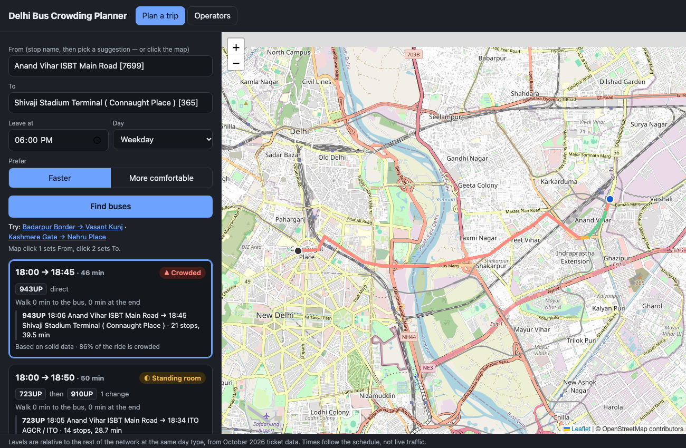

# Delhi bus crowding planner

Transport Stack Hackathon 2026, **Problem 2: crowdedness-aware journey planner**.

We turn 2.56 million October 2026 bus tickets and the static Delhi GTFS feed into a **relative crowding level (seats / standing / crowded) for every route stretch, day type and hour**, serve it through an API, and show it next to each journey option in a planner and map.



| Read this | What it is |
|---|---|
| [NOTE.md](NOTE.md) | Technical note: method, assumptions, where estimates are least reliable |
| [reports/validation.md](reports/validation.md) | Checks against known patterns (peaks, weekday vs weekend, week-to-week stability) |
| [PLAN.md](PLAN.md) | Implementation plan and phase status |
| [SUBMISSION.md](SUBMISSION.md) | Proposal text and submission checklist |

## Run it

Python 3.13 was used (3.11+ should work). From a clean clone:

```bash
python3 -m venv .venv && source .venv/bin/activate
pip install -r requirements.txt
# put the data in place (see "Data" below), then:
bash scripts/run_all.sh          # GTFS tables, model, validation report, tests (under 2 minutes)
uvicorn api.main:app             # open http://localhost:8000/   (API docs at /docs)
```

The web page loads map tiles from OpenStreetMap, so it needs internet.

## Data

The data is **not in this repository** (the ticket CSV is 290 MB and GTFS `stop_times.txt` is 116 MB). Get it from Transport Stack (https://delhi.transportstack.in, see `data_README`) and place it so:

```
data/raw/October-Delhi.csv        # unzip October-Delhi.csv.zip into data/raw/
data/gtfs/stops.txt  routes.txt  trips.txt  stop_times.txt  calendar.txt  shapes.txt ...
```
`python scripts/check_gtfs.py` lists which GTFS files are present and how well ticket routes and stop names match them. Everything under `data/` is gitignored; generated tables go to `data/processed/`.

## What each step does

| Step | Command | Output |
|---|---|---|
| GTFS tables and stop matching | `python scripts/build_gtfs_tables.py` | `data/processed/route_stops.csv`, `trips_per_hour.csv`, `trip_starts.csv`, `stop_match.csv` |
| Crowding model | `python run_pipeline.py` | `data/processed/crowding.csv.gz` (1.56M route-stretch-hour cells) |
| Validation | `python -m crowding.validate` | `reports/validation.md` and charts |
| Tests | `pytest -q` | 11 tests; skipped if processed data is missing |

Code layout: `crowding/` (clean, gtfs, model, planner, validate, config), `api/` (FastAPI), `web/` (demo page), `scripts/`, `tests/`. All assumed numbers (bus capacity, pass-holder uplift, sample rate, thresholds) are in `crowding/config.py`.

## API

Interactive docs at `/docs`.

| Endpoint | Purpose |
|---|---|
| `GET /meta` | Level and confidence definitions, all assumed numbers |
| `GET /routes?q=717` | Routes with peak hour and level (weekday and weekend) |
| `GET /routes/{route}/profile?weekend=false` | Hour-by-hour crowding for a route |
| `GET /crowding?route=717AUP&hour=18&weekend=false` | Crowding on every stretch of a route, in route order |
| `GET /heatmap?hour=18&min_confidence=medium&by=route` | Most overloaded routes or stretches (for operators) |
| `GET /stops?q=kashmere` | Stop search with coordinates |
| `GET /journeys?from=7699&to=365&depart=18:00&prefer=comfort` | Bus journeys (direct or one transfer) with scheduled times and a crowding level. `from` and `to` are a stop_id or `lat,lon` |

Levels are **relative** to the rest of the network at the same day type, not headcounts, and every cell carries a `confidence` (66% of cells are low confidence because tickets are thin; see NOTE.md).

## Demo page

`http://localhost:8000/`
- **Plan a trip:** type a stop name and pick a suggestion, or click the map twice (From, then To). Choose time, day type and Faster or More comfortable.
- **Operators:** most crowded routes or stretches by hour, with a minimum-confidence filter. Click a row to see it on the map.
- Shareable links: `/?from=7699&to=365&depart=18:00&prefer=comfort` and `/?tab=ops`.

Times follow the GTFS schedule, not live traffic. The planner supports direct trips and one transfer only.
