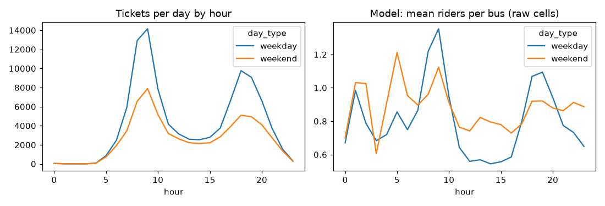
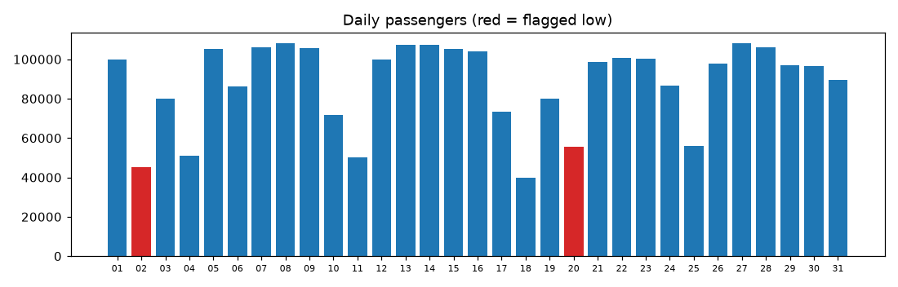

# Validation report

Generated by `python -m crowding.validate` from the October 2026 ticket data and the static GTFS feed.

## 0. Coverage

- Tickets used: 2,527,920; placed on the GTFS stop order: 2,056,066 (81.3%).
- Day types: 20 weekday-like days, 11 weekend-like days (holidays 2026-10-02, 2026-10-20 counted as weekend-like).
- Model cells: 1,556,032; own-ticket (raw) cells: 299,493 (19.2%).

## 1. Morning and evening peaks

- Weekday ticket peak hours: **9:00** (morning) and **18:00** (evening). Midday (12-15h) average is 20% of the peak. Check passes: yes.
- Model riders per bus (raw cells, weekday) peaks at **9:00** and **19:00**.

## 2. Weekday vs weekend

Mean daily passengers by weekday (all days): Mon 95,695, Tue 89,297, Wed 104,547, Thu 102,153, Fri 90,420, Sat 80,267, Sun 49,297.

- Weekday-like day: 101,014 passengers/day; weekend-like: 63,569 (63% of weekday). Sunday is the lowest day: yes.
- Model mean riders per bus: weekday 0.368, weekend 0.242 (weekend lower: yes).

## 3. Busiest corridors

Top 10 routes by total tickets: 717AUP, 717ADOWN, 729DOWN, 729UP, 511AUP, 511ADOWN, 623UP, 623DOWN, 717BDOWN, 578UP.

Top 10 routes by weekday peak riders per bus (high-confidence cells only):

| route | riders_per_bus |
|---|---|
| D-7701AUP | 11.933 |
| 525UP | 5.946 |
| 34AUP | 5.645 |
| 717BDOWN | 5.379 |
| 717UP | 4.835 |
| 525DOWN | 4.643 |
| 717DOWN | 4.461 |
| 548DOWN | 4.412 |
| 717AUP | 4.266 |
| 423DOWN | 3.914 |

Spearman correlation between route ticket volume and peak riders per bus: -0.01 (n=763). The two are essentially uncorrelated: busy routes also run more buses, which lowers riders per bus; peak riders per bus vs scheduled buses per hour: -0.55. Per-bus figures use at least 2 buses per hour and thinner cells are marked low confidence, because before this floor the top of the ranking was routes with 1-2 scheduled buses an hour. Routes at the top may still be genuinely crowded infrequent services, or services the GTFS schedule undercounts.

Top 10 route stretches at 18:00 on weekdays (high confidence):

| route | from_stop | to_stop | riders_per_bus | level |
|---|---|---|---|---|
| 717BDOWN | VASANT KUNJ BUS STAND / Vasant Kunj sec B-1 | Vasant Kunj SecD/34 | 12.683 | crowded |
| 717BDOWN | Masood Pur Village | VASANT KUNJ BUS STAND / Vasant Kunj sec B-1 | 12.450 | crowded |
| 717BDOWN | Maidan Garhi Crossing (SDM Court) | Saket Crossing | 12.200 | crowded |
| 717BDOWN | Masood Pur Dairy | Masood Pur Village | 12.167 | crowded |
| 717BDOWN | Saket Crossing | Asian Market | 11.983 | crowded |
| 717BDOWN | Asian Market | DIPSAR College of Pharmacy / Ambedkar Nagar (T.) | 11.867 | crowded |
| 717BDOWN | Said ul zeb Village | Maidan Garhi Crossing (SDM Court) | 11.767 | crowded |
| 717BDOWN | Kathuria Public School/Vasant Kunj D7 | Masood Pur Dairy | 11.667 | crowded |
| 717BDOWN | DIPSAR College of Pharmacy / Ambedkar Nagar (T.) | Ambedkar Nagar Terminal | 11.467 | crowded |
| 717BDOWN | ISIC Hospital | Kathuria Public School/Vasant Kunj D7 | 10.950 | crowded |

## 4. Week-to-week stability (weekdays, weeks 1-4)

| weeks | cells_raw_both | spearman_cell | same_level | route_hours | spearman_route_hour |
|---|---|---|---|---|---|
| 1 vs 2 | 39363 | 0.889 | 0.901 | 17175 | 0.853 |
| 1 vs 3 | 32461 | 0.883 | 0.915 | 16561 | 0.827 |
| 1 vs 4 | 38743 | 0.885 | 0.897 | 16933 | 0.832 |
| 2 vs 3 | 38308 | 0.903 | 0.912 | 16969 | 0.864 |
| 2 vs 4 | 48749 | 0.907 | 0.898 | 17399 | 0.867 |
| 3 vs 4 | 38564 | 0.909 | 0.914 | 16961 | 0.869 |

Mean Spearman: 0.90 at stretch level (own tickets in both weeks), 0.85 at route-hour level; same crowding level in 91% of cells. Both figures are optimistic: the stretch-level numbers only cover cells with enough tickets in both weeks, and the route-hour numbers include route-average fallback values that agree by construction. Thinly sampled cells (60% of the model) are not covered by this check.

## 5. Anomalous days

Days whose volume is under 65% of the median for the same weekday are flagged and treated as holiday-like:

| date | dow | pax | ratio | flag |
|---|---|---|---|---|
| 2026-10-02 | Fri | 45207 | 0.450 | LOW |
| 2026-10-18 | Sun | 39664 | 0.782 |  |
| 2026-10-20 | Tue | 55531 | 0.574 | LOW |

## 6. Ride length sanity

Placed tickets span a median of 10 stops (mean 12.6, 90th percentile 25). This looks plausible for Delhi bus rides and shows stop matching is not producing absurd spans, but it is not a proof of correct matching.

## 7. Where estimates are least reliable

Confidence by source:

| source | high | low | medium |
|---|---|---|---|
| pooled_hours | 0.000 | 0.042 | 0.170 |
| raw | 0.073 | 0.019 | 0.101 |
| route_average | 0.000 | 0.595 | 0.000 |

- Share of low-confidence cells by hour is highest at 0:00 (98%) and lowest at 9:00 (54%); overall 72%. Late-night and early-morning hours are the weakest.
- Low-confidence share by route size (ticket volume quartile): smallest 100%, small 98%, large 86%, largest 44%.
- 18.7% of tickets could not be placed (unmatched stop names or wrong direction); routes with poor stop naming are under-counted.
- Ticket data is a sample with no pass holders or bus size; levels are relative, not headcounts (see `crowding/config.py`).
- Scheduled frequency assumes every trip runs the full route and ignores actual delays; no real-time data is used.
